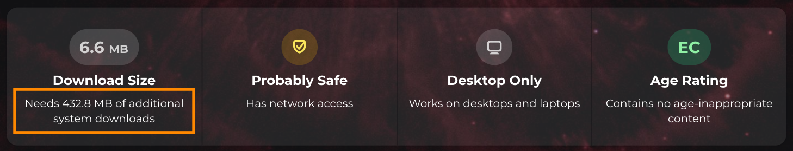

# flatpak-apps


[](https://github.com/Infiniti151/flatpak-apps/issues/new?template=app_request.md)
[](https://github.com/Infiniti151/flatpak-apps/issues/new?template=bug_report.md)

[](#app-list)
[](https://copr.fedorainfracloud.org/coprs/infiniti151/flatpak-apps/)
[](https://fedoraproject.org/)

[](https://github.com/Infiniti151/flatpak-apps/blob/main/LICENSE)

Collection of Flatpak apps packaged as native RPMs for Fedora Linux, available through [Copr](https://copr.fedorainfracloud.org/coprs/infiniti151/flatpak-apps/).

> [!IMPORTANT]
> Support is primarily targeted at current Fedora releases and Rawhide. Older supported Fedora releases (such as the lowest active version) and Fedora ELN are provided on a best-effort basis and are not treated as first-class targets.

## Why



Flatpak apps depend on a runtime (GNOME Platform, drivers, extras) that is separate from your system's libraries, even if your desktop already runs the same GNOME version. Runtimes can be hundreds of MB, and each runtime branch is downloaded separately, so apps built against different GNOME versions can leave you with several copies. A small app can end up costing far more in dependencies than in its own size.

AppImage avoids the runtime by bundling libraries inside each app, and it runs from a compressed image mounted through FUSE, which can slow startup.

These RPMs are ordinary packages that link against the libraries Fedora already provides, so you download only the app (plus any packages you don't already have) and updates come through `dnf`.

> [!NOTE]
> **UPX Compression:** Some packages ship binaries compressed with [UPX](https://upx.github.io/) to reduce installed size. This saves disk space, though it adds a slight startup delay while the binary decompresses.
>
> **No Sandboxing & Rebuilds:** Native RPMs run without Flatpak's sandbox and link directly against Fedora's system libraries, so major Fedora updates can occasionally require a package rebuild.

## App List

| App | Icon | Links | Version | COPR Build Status |
| :---: | :---: | :---: | :---: | :---: |
| aerion | <p align="center"></p> | [Flathub](https://flathub.org/en/apps/io.github.hkdb.Aerion) • [GitHub](https://github.com/hkdb/aerion) | 0.3.6 | [](https://copr.fedorainfracloud.org/coprs/infiniti151/flatpak-apps/package/aerion/) |
| amberol | <p align="center"></p> | [Flathub](https://flathub.org/en/apps/io.bassi.Amberol) • [GitLab](https://gitlab.gnome.org/World/amberol) | 2026.1 | [](https://copr.fedorainfracloud.org/coprs/infiniti151/flatpak-apps/package/amberol/) |
| bobby | <p align="center"></p> | [Flathub](https://flathub.org/en/apps/studio.planetpeanut.Bobby) • [GitHub](https://github.com/hbons/Bobby) | 51.0.2 | [](https://copr.fedorainfracloud.org/coprs/infiniti151/flatpak-apps/package/bobby/) |
| calligraphy | <p align="center"></p> | [Flathub](https://flathub.org/en/apps/dev.geopjr.Calligraphy) • [Codeberg](https://codeberg.org/GeopJr/calligraphy) | 1.3.0 | [](https://copr.fedorainfracloud.org/coprs/infiniti151/flatpak-apps/package/calligraphy/) |
| censor | <p align="center"></p> | [Flathub](https://flathub.org/en/apps/page.codeberg.censor.Censor) • [Codeberg](https://codeberg.org/censor/censor) | 0.10.2 | [](https://copr.fedorainfracloud.org/coprs/infiniti151/flatpak-apps/package/censor/) |
| chess-clock | <p align="center"></p> | [Flathub](https://flathub.org/en/apps/eu.fortysixandtwo.chessclock) • [GitLab](https://gitlab.gnome.org/World/chess-clock) | 0.6.3 | [](https://copr.fedorainfracloud.org/coprs/infiniti151/flatpak-apps/package/chess-clock/) |
| citations | <p align="center"></p> | [Flathub](https://flathub.org/en/apps/org.gnome.World.Citations) • [GitLab](https://gitlab.gnome.org/World/citations) | 0.11.0 | [](https://copr.fedorainfracloud.org/coprs/infiniti151/flatpak-apps/package/citations/) |
| clairvoyant | <p align="center"></p> | [Flathub](https://flathub.org/en/apps/com.cassidyjames.clairvoyant) • [GitHub](https://github.com/cassidyjames/clairvoyant) | 3.1.14 | [](https://copr.fedorainfracloud.org/coprs/infiniti151/flatpak-apps/package/clairvoyant/) |
| clicker | <p align="center"></p> | [Flathub](https://flathub.org/en/apps/net.codelogistics.clicker) • [GitLab](https://gitlab.gnome.org/eyekay/clicker) | 0.2.0 | [](https://copr.fedorainfracloud.org/coprs/infiniti151/flatpak-apps/package/clicker/) |
| collision | <p align="center"></p> | [Flathub](https://flathub.org/en/apps/dev.geopjr.Collision) • [Codeberg](https://codeberg.org/GeopJr/collision) | 3.14.1 | [](https://copr.fedorainfracloud.org/coprs/infiniti151/flatpak-apps/package/collision/) |
| commit | <p align="center"></p> | [Flathub](https://flathub.org/en/apps/re.sonny.Commit) • [GitHub](https://github.com/sonnyp/Commit) | 4.6 | [](https://copr.fedorainfracloud.org/coprs/infiniti151/flatpak-apps/package/commit/) |
| concessio | <p align="center"></p> | [Flathub](https://flathub.org/en/apps/io.github.ronniedroid.concessio) • [GitHub](https://github.com/ronniedroid/concessio) | 1.0.0 | [](https://copr.fedorainfracloud.org/coprs/infiniti151/flatpak-apps/package/concessio/) |
| coronet | <p align="center"></p> | [Flathub](https://flathub.org/en/apps/page.codeberg.petsoi.coronet) • [Codeberg](https://codeberg.org/petsoi/coronet) | 0.8.1 | [](https://copr.fedorainfracloud.org/coprs/infiniti151/flatpak-apps/package/coronet/) |
| crosspipe | <p align="center"></p> | [Flathub](https://flathub.org/en/apps/io.github.dp0sk.Crosspipe) • [GitHub](https://github.com/dp0sk/Crosspipe) | 0.1.1 | [](https://copr.fedorainfracloud.org/coprs/infiniti151/flatpak-apps/package/crosspipe/) |
| decoder | <p align="center"></p> | [Flathub](https://flathub.org/en/apps/com.belmoussaoui.Decoder) • [GitLab](https://gitlab.gnome.org/World/decoder) | 0.10.0 | [](https://copr.fedorainfracloud.org/coprs/infiniti151/flatpak-apps/package/decoder/) |
| drum-machine | <p align="center"></p> | [Flathub](https://flathub.org/en/apps/io.github.revisto.drum-machine) • [GitHub](https://github.com/Revisto/drum-machine) | 2.2.0 | [](https://copr.fedorainfracloud.org/coprs/infiniti151/flatpak-apps/package/drum-machine/) |
| eartag | <p align="center"></p> | [Flathub](https://flathub.org/en/apps/app.drey.EarTag) • [GitLab](https://gitlab.gnome.org/World/eartag) | 1.0.3 | [](https://copr.fedorainfracloud.org/coprs/infiniti151/flatpak-apps/package/eartag/) |
| egghead | <p align="center"></p> | [Flathub](https://flathub.org/en/apps/io.github.josephmawa.Egghead) • [GitHub](https://github.com/josephmawa/Egghead) | 0.1.5 | [](https://copr.fedorainfracloud.org/coprs/infiniti151/flatpak-apps/package/egghead/) |
| elastic | <p align="center"></p> | [Flathub](https://flathub.org/en/apps/app.drey.Elastic) • [GitLab](https://gitlab.gnome.org/World/elastic) | 1.0.4 | [](https://copr.fedorainfracloud.org/coprs/infiniti151/flatpak-apps/package/elastic/) |
| embellish | <p align="center"></p> | [Flathub](https://flathub.org/en/apps/io.github.getnf.embellish) • [GitHub](https://github.com/getnf/embellish) | 1.2.0 | [](https://copr.fedorainfracloud.org/coprs/infiniti151/flatpak-apps/package/embellish/) |
| emblem | <p align="center"></p> | [Flathub](https://flathub.org/en/apps/org.gnome.design.Emblem) • [GitLab](https://gitlab.gnome.org/World/design/emblem) | 1.7.0 | [](https://copr.fedorainfracloud.org/coprs/infiniti151/flatpak-apps/package/emblem/) |
| emergency-alerts | <p align="center"></p> | [Flathub](https://flathub.org/en/apps/io.github.leolost2605.emergency-alerts) • [GitHub](https://github.com/leolost2605/emergency-alerts) | 2.1.0 | [](https://copr.fedorainfracloud.org/coprs/infiniti151/flatpak-apps/package/emergency-alerts/) |
| encoding-explorer | <p align="center"></p> | [Flathub](https://flathub.org/en/apps/io.github.josephmawa.EncodingExplorer) • [GitHub](https://github.com/josephmawa/EncodingExplorer) | 0.1.5 | [](https://copr.fedorainfracloud.org/coprs/infiniti151/flatpak-apps/package/encoding-explorer/) |
| exchange | <p align="center"></p> | [Flathub](https://flathub.org/en/apps/io.github.shonebinu.Exchange) • [GitHub](https://github.com/shonebinu/Exchange) | 0.2.2 | [](https://copr.fedorainfracloud.org/coprs/infiniti151/flatpak-apps/package/exchange/) |
| exercise-timer | <p align="center"></p> | [Flathub](https://flathub.org/en/apps/xyz.safeworlds.hiit) • [GitLab](https://gitlab.gnome.org/World/exercise-timer) | 1.11.0 | [](https://copr.fedorainfracloud.org/coprs/infiniti151/flatpak-apps/package/exercise-timer/) |
| extension-manager | <p align="center"></p> | [Flathub](https://flathub.org/en/apps/com.mattjakeman.ExtensionManager) • [GitHub](https://github.com/mjakeman/extension-manager) | 0.7.0 | [](https://copr.fedorainfracloud.org/coprs/infiniti151/flatpak-apps/package/extension-manager/) |
| eyedropper | <p align="center"></p> | [Flathub](https://flathub.org/en/apps/com.github.finefindus.eyedropper) • [GitHub](https://github.com/finefindus/eyedropper) | 2.2.1 | [](https://copr.fedorainfracloud.org/coprs/infiniti151/flatpak-apps/package/eyedropper/) |
| flattool-ignition | <p align="center"></p> | [Flathub](https://flathub.org/en/apps/io.github.flattool.Ignition) • [GitHub](https://github.com/flattool/ignition) | 2.4.1 | [](https://copr.fedorainfracloud.org/coprs/infiniti151/flatpak-apps/package/flattool-ignition/) |
| fretboard | <p align="center"></p> | [Flathub](https://flathub.org/en/apps/dev.bragefuglseth.Fretboard) • [GitHub](https://github.com/bragefuglseth/fretboard) | 9.1 | [](https://copr.fedorainfracloud.org/coprs/infiniti151/flatpak-apps/package/fretboard/) |
| gitte | <p align="center"></p> | [Flathub](https://flathub.org/en/apps/de.wwwtech.gitte) • [Codeberg](https://codeberg.org/ckruse/gitte) | 0.11.1 | [](https://copr.fedorainfracloud.org/coprs/infiniti151/flatpak-apps/package/gitte/) |
| graphs | <p align="center"></p> | [Flathub](https://flathub.org/en/apps/se.sjoerd.Graphs) • [GitLab](https://gitlab.gnome.org/World/Graphs) | 2.0.9 | [](https://copr.fedorainfracloud.org/coprs/infiniti151/flatpak-apps/package/graphs/) |
| griddle | <p align="center"></p> | [Flathub](https://flathub.org/en/apps/page.codeberg.petsoi.griddle) • [Codeberg](https://codeberg.org/petsoi/griddle) | 0.3.4 | [](https://copr.fedorainfracloud.org/coprs/infiniti151/flatpak-apps/package/griddle/) |
| hieroglyphic | <p align="center"></p> | [Flathub](https://flathub.org/en/apps/io.github.finefindus.Hieroglyphic) • [GitHub](https://github.com/FineFindus/Hieroglyphic) | 2.3.0 | [](https://copr.fedorainfracloud.org/coprs/infiniti151/flatpak-apps/package/hieroglyphic/) |
| icon-library | <p align="center"></p> | [Flathub](https://flathub.org/en/apps/org.gnome.design.IconLibrary) • [GitLab](https://gitlab.gnome.org/World/design/icon-library) | 0.0.23 | [](https://copr.fedorainfracloud.org/coprs/infiniti151/flatpak-apps/package/icon-library/) |
| iconic | <p align="center"></p> | [Flathub](https://flathub.org/en/apps/nl.emphisia.icon) • [GitHub](https://github.com/youpie/Iconic) | 2026.8.1 | [](https://copr.fedorainfracloud.org/coprs/infiniti151/flatpak-apps/package/iconic/) |
| identity | <p align="center"></p> | [Flathub](https://flathub.org/en/apps/org.gnome.gitlab.YaLTeR.Identity) • [GitLab](https://gitlab.gnome.org/YaLTeR/identity) | 26.03 | [](https://copr.fedorainfracloud.org/coprs/infiniti151/flatpak-apps/package/identity/) |
| inscriptions | <p align="center"></p> | [Flathub](https://flathub.org/en/apps/page.codeberg.elly_code.inscriptions) • [Codeberg](https://codeberg.org/elly-code/inscriptions) | 1.2.1 | [](https://copr.fedorainfracloud.org/coprs/infiniti151/flatpak-apps/package/inscriptions/) |
| junction | <p align="center"></p> | [Flathub](https://flathub.org/en/apps/re.sonny.Junction) • [GitHub](https://github.com/sonnyp/Junction) | 1.13 | [](https://copr.fedorainfracloud.org/coprs/infiniti151/flatpak-apps/package/junction/) |
| keypunch | <p align="center"></p> | [Flathub](https://flathub.org/en/apps/no.bragefuglseth.Keypunch) • [GitHub](https://github.com/bragefuglseth/keypunch) | 7.0 | [](https://copr.fedorainfracloud.org/coprs/infiniti151/flatpak-apps/package/keypunch/) |
| konbucase | <p align="center"></p> | [Flathub](https://flathub.org/en/apps/com.github.ryonakano.konbucase) • [GitHub](https://github.com/ryonakano/konbucase) | 5.0.0 | [](https://copr.fedorainfracloud.org/coprs/infiniti151/flatpak-apps/package/konbucase/) |
| laser | <p align="center"></p> | [Flathub](https://flathub.org/en/apps/nl.andreasknoben.Laser) • [Codeberg](https://codeberg.org/andreasknoben/laser) | 0.5.0 | [](https://copr.fedorainfracloud.org/coprs/infiniti151/flatpak-apps/package/laser/) |
| lorem | <p align="center"></p> | [Flathub](https://flathub.org/en/apps/org.gnome.design.Lorem) • [GitLab](https://gitlab.gnome.org/World/design/lorem) | 1.7 | [](https://copr.fedorainfracloud.org/coprs/infiniti151/flatpak-apps/package/lorem/) |
| lyricade | <p align="center"></p> | [Flathub](https://flathub.org/en/apps/io.github.weiteck.Lyricade) • [GitHub](https://github.com/weiteck/lyricade) | 0.7.0 | [](https://copr.fedorainfracloud.org/coprs/infiniti151/flatpak-apps/package/lyricade/) |
| memerist | <p align="center"></p> | [Flathub](https://flathub.org/en/apps/io.github.vani_tty1.memerist) • [GitHub](https://github.com/vani-tty1/memerist) | 2.6.1 | [](https://copr.fedorainfracloud.org/coprs/infiniti151/flatpak-apps/package/memerist/) |
| missioncenter | <p align="center"></p> | [Flathub](https://flathub.org/en/apps/io.missioncenter.MissionCenter) • [GitLab](https://gitlab.com/mission-center-devs/mission-center) | 1.2.0 | [](https://copr.fedorainfracloud.org/coprs/infiniti151/flatpak-apps/package/missioncenter/) |
| morse | <p align="center"></p> | [Flathub](https://flathub.org/en/apps/io.github.teacond.Morse) • [GitHub](https://github.com/teacond/Morse) | 1.5.0 | [](https://copr.fedorainfracloud.org/coprs/infiniti151/flatpak-apps/package/morse/) |
| mousam | <p align="center"></p> | [Flathub](https://flathub.org/en/apps/io.github.amit9838.mousam) • [GitHub](https://github.com/amit9838/mousam) | 3.1.0 | [](https://copr.fedorainfracloud.org/coprs/infiniti151/flatpak-apps/package/mousam/) |
| mundi | <p align="center"></p> | [Flathub](https://flathub.org/en/apps/io.github.nacho.mundi) • [GitHub](https://github.com/nacho/mundi) | 1.3.0 | [](https://copr.fedorainfracloud.org/coprs/infiniti151/flatpak-apps/package/mundi/) |
| netpeek | <p align="center"></p> | [Flathub](https://flathub.org/en/apps/io.github.zingytomato.netpeek) • [GitHub](https://github.com/ZingyTomato/NetPeek) | 0.3.5 | [](https://copr.fedorainfracloud.org/coprs/infiniti151/flatpak-apps/package/netpeek/) |
| newsflash | <p align="center"></p> | [Flathub](https://flathub.org/en/apps/io.gitlab.news_flash.NewsFlash) • [GitLab](https://gitlab.com/news-flash/news_flash_gtk) | 6.0.2 | [](https://copr.fedorainfracloud.org/coprs/infiniti151/flatpak-apps/package/newsflash/) |
| nucleus | <p align="center"></p> | [Flathub](https://flathub.org/en/apps/page.codeberg.lo_vely.Nucleus) • [Codeberg](https://codeberg.org/lo-vely/nucleus) | 3 | [](https://copr.fedorainfracloud.org/coprs/infiniti151/flatpak-apps/package/nucleus/) |
| obfuscate | <p align="center"></p> | [Flathub](https://flathub.org/en/apps/com.belmoussaoui.ObfuscateDevel) • [GitLab](https://gitlab.gnome.org/World/obfuscate) | 0.0.10 | [](https://copr.fedorainfracloud.org/coprs/infiniti151/flatpak-apps/package/obfuscate/) |
| picker | <p align="center"></p> | [Flathub](https://flathub.org/en/apps/io.github.mezoahmedii.Picker) • [GitHub](https://github.com/mezoahmedii/picker) | 1.4.1 | [](https://copr.fedorainfracloud.org/coprs/infiniti151/flatpak-apps/package/picker/) |
| pigment | <p align="center"></p> | [Flathub](https://flathub.org/en/apps/com.jeffser.Pigment) • [GitHub](https://github.com/Jeffser/Pigment) | 0.5.6 | [](https://copr.fedorainfracloud.org/coprs/infiniti151/flatpak-apps/package/pigment/) |
| planify | <p align="center"></p> | [Flathub](https://flathub.org/en/apps/io.github.alainm23.planify) • [GitHub](https://github.com/alainm23/planify) | 4.20.0 | [](https://copr.fedorainfracloud.org/coprs/infiniti151/flatpak-apps/package/planify/) |
| pods | <p align="center"></p> | [Flathub](https://flathub.org/en/apps/com.github.marhkb.Pods) • [GitHub](https://github.com/marhkb/Pods) | 3.3.0 | [](https://copr.fedorainfracloud.org/coprs/infiniti151/flatpak-apps/package/pods/) |
| pully | <p align="center"></p> | [Flathub](https://flathub.org/en/apps/page.codeberg.petsoi.pully) • [Codeberg](https://codeberg.org/petsoi/pully) | 0.2.2 | [](https://copr.fedorainfracloud.org/coprs/infiniti151/flatpak-apps/package/pully/) |
| pwvucontrol | <p align="center"></p> | [Flathub](https://flathub.org/en/apps/com.saivert.pwvucontrol) • [GitHub](https://github.com/saivert/pwvucontrol) | 0.5.3 | [](https://copr.fedorainfracloud.org/coprs/infiniti151/flatpak-apps/package/pwvucontrol/) |
| queue | <p align="center"></p> | [Flathub](https://flathub.org/en/apps/io.github.dprietob.queue) • [GitHub](https://github.com/dprietob/queue) | 1.1.0 | [](https://copr.fedorainfracloud.org/coprs/infiniti151/flatpak-apps/package/queue/) |
| raider | <p align="center"></p> | [Flathub](https://flathub.org/en/apps/com.github.ADBeveridge.Raider) • [GitHub](https://github.com/ADBeveridge/raider) | 3.1.0 | [](https://copr.fedorainfracloud.org/coprs/infiniti151/flatpak-apps/package/raider/) |
| railway | <p align="center"></p> | [Flathub](https://flathub.org/en/apps/de.schmidhuberj.DieBahn) • [GitLab](https://gitlab.com/schmiddi-on-mobile/railway) | 2.10.1 | [](https://copr.fedorainfracloud.org/coprs/infiniti151/flatpak-apps/package/railway/) |
| ratio | <p align="center"></p> | [Flathub](https://flathub.org/en/apps/com.markwyner.ratio) • [Codeberg](https://codeberg.org/markwyner/ratio-for-linux) | 1.0.6 | [](https://copr.fedorainfracloud.org/coprs/infiniti151/flatpak-apps/package/ratio/) |
| recent-filter | <p align="center"></p> | [Flathub](https://flathub.org/en/apps/io.github.unrud.RecentFilter) • [GitHub](https://github.com/Unrud/recent-filter) | 0.1.10 | [](https://copr.fedorainfracloud.org/coprs/infiniti151/flatpak-apps/package/recent-filter/) |
| reco | <p align="center"></p> | [Flathub](https://flathub.org/en/apps/com.github.ryonakano.reco) • [GitHub](https://github.com/ryonakano/reco) | 5.2.2 | [](https://copr.fedorainfracloud.org/coprs/infiniti151/flatpak-apps/package/reco/) |
| rustdiff | <p align="center"></p> | [Flathub](https://flathub.org/en/apps/com.digitalgex.RustDiff) • [GitHub](https://github.com/jereok91/rustdiff) | 1.0.6 | [](https://copr.fedorainfracloud.org/coprs/infiniti151/flatpak-apps/package/rustdiff/) |
| scribble | <p align="center"></p> | [Flathub](https://flathub.org/en/apps/page.codeberg.petsoi.scribble) • [Codeberg](https://codeberg.org/petsoi/scribble) | 1.14.0 | [](https://copr.fedorainfracloud.org/coprs/infiniti151/flatpak-apps/package/scribble/) |
| shortwave | <p align="center"></p> | [Flathub](https://flathub.org/en/apps/de.haeckerfelix.Shortwave) • [GitLab](https://gitlab.gnome.org/World/Shortwave) | 5.1.0 | [](https://copr.fedorainfracloud.org/coprs/infiniti151/flatpak-apps/package/shortwave/) |
| sitra | <p align="center"></p> | [Flathub](https://flathub.org/en/apps/io.github.sitraorg.sitra) • [GitHub](https://github.com/sitraorg/sitra) | 0.2.0 | [](https://copr.fedorainfracloud.org/coprs/infiniti151/flatpak-apps/package/sitra/) |
| spellingbee | <p align="center"></p> | [Flathub](https://flathub.org/en/apps/io.github.josephmawa.SpellingBee) • [GitHub](https://github.com/josephmawa/SpellingBee) | 0.1.8 | [](https://copr.fedorainfracloud.org/coprs/infiniti151/flatpak-apps/package/spellingbee/) |
| sudoku | <p align="center"></p> | [Flathub](https://flathub.org/en/apps/io.github.sepehr_rs.Sudoku) • [GitHub](https://github.com/sepehr-rs/Sudoku) | 1.8.0 | [](https://copr.fedorainfracloud.org/coprs/infiniti151/flatpak-apps/package/sudoku/) |
| tags | <p align="center"></p> | [Flathub](https://flathub.org/en/apps/io.github.phastmike.tags) • [GitHub](https://github.com/phastmike/tags) | 2.6 | [](https://copr.fedorainfracloud.org/coprs/infiniti151/flatpak-apps/package/tags/) |
| text-compare | <p align="center"></p> | [Flathub](https://flathub.org/en/apps/io.github.josephmawa.TextCompare) • [GitHub](https://github.com/josephmawa/TextCompare) | 0.1.12 | [](https://copr.fedorainfracloud.org/coprs/infiniti151/flatpak-apps/package/text-compare/) |
| text-pieces | <p align="center"></p> | [Flathub](https://flathub.org/en/apps/io.gitlab.liferooter.TextPieces) • [GitLab](https://gitlab.com/liferooter/textpieces) | 4.3.2 | [](https://copr.fedorainfracloud.org/coprs/infiniti151/flatpak-apps/package/text-pieces/) |
| tomatillo | <p align="center"></p> | [Flathub](https://flathub.org/en/apps/io.github.diegopvlk.Tomatillo) • [GitHub](https://github.com/diegopvlk/Tomatillo) | 1.1.1 | [](https://copr.fedorainfracloud.org/coprs/infiniti151/flatpak-apps/package/tomatillo/) |
| transition | <p align="center"></p> | [Flathub](https://flathub.org/en/apps/page.codeberg.grinka.Transition) • [Codeberg](https://codeberg.org/grinka/transition) | 4.0 | [](https://copr.fedorainfracloud.org/coprs/infiniti151/flatpak-apps/package/transition/) |
| video-trimmer | <p align="center"></p> | [Flathub](https://flathub.org/en/apps/org.gnome.gitlab.YaLTeR.VideoTrimmer) • [GitLab](https://gitlab.gnome.org/YaLTeR/video-trimmer) | 26.03.1 | [](https://copr.fedorainfracloud.org/coprs/infiniti151/flatpak-apps/package/video-trimmer/) |
| warehouse | <p align="center"></p> | [Flathub](https://flathub.org/en/apps/io.github.flattool.Warehouse) • [GitHub](https://github.com/flattool/warehouse) | 2.2.0 | [](https://copr.fedorainfracloud.org/coprs/infiniti151/flatpak-apps/package/warehouse/) |
| wildcard | <p align="center"></p> | [Flathub](https://flathub.org/en/apps/net.ffkkinos.Wildcard) • [GitLab](https://gitlab.gnome.org/World/Wildcard) | 0.3.5 | [](https://copr.fedorainfracloud.org/coprs/infiniti151/flatpak-apps/package/wildcard/) |
| words-game | <p align="center"></p> | [Flathub](https://flathub.org/en/apps/page.codeberg.petsoi.words) • [Codeberg](https://codeberg.org/petsoi/words) | 0.8.1 | [](https://copr.fedorainfracloud.org/coprs/infiniti151/flatpak-apps/package/words-game/) |

> [!NOTE]
> The failed builds are only for Fedora 43 and ELN because these applications require newer dependencies (such as GTK 4.22+ and Libadwaita 1.9+) that are not available in those repositories.
>
> **Recommendation:** Upgrade to a newer Fedora release or use the **Flatpak** versions for these specific apps.

## Installation

### Enable Copr repo

   `sudo dnf copr enable infiniti151/flatpak-apps`

### Install app

   `sudo dnf install <app>`

## Browsing Packages

You can list everything in the repo from the terminal. This needs `copr-cli` and `jq`, and no Copr account:

`sudo dnf install copr-cli jq`

### List apps

```
copr-cli list-packages infiniti151/flatpak-apps | jq -r '.[] | select((.source_dict.subdirectory // "") | startswith("apps/")) | .name' | sort
```

### List libraries

```
copr-cli list-packages infiniti151/flatpak-apps | jq -r '.[] | select((.source_dict.subdirectory // "") | startswith("libs/")) | .name' | sort
```

### Inspect a spec file

Replace `<app>` with a package name from the list above:

```
curl -sL https://raw.githubusercontent.com/Infiniti151/flatpak-apps/main/apps/<app>/<app>.spec
```

For a library, use the `libs` directory instead:

```
curl -sL https://raw.githubusercontent.com/Infiniti151/flatpak-apps/main/libs/<lib>/<lib>.spec
```

> [!TIP]
> Pipe the output into `less` (or `bat -l spec`) to page through long spec files.

## License

This packaging repository (`flatpak-apps`) is licensed under the terms of the [LICENSE](LICENSE) file in this repository. Individual applications in the [App List](#app-list) are distributed under their respective upstream open-source licenses; check each project's repository or installed package metadata (`rpm -qi <app>`) for details.
