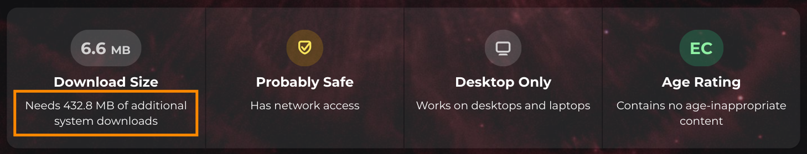

#  flatpak-apps

Collection of Flatpak apps packaged as native RPMs for Fedora Linux, available through [Copr](https://copr.fedorainfracloud.org/coprs/infiniti151/flatpak-apps/).

## Why

Flatpak apps depend on a runtime (GNOME Platform, drivers, extras) that is separate from your system's libraries, even if your desktop already runs the same GNOME version. Runtimes can be hundreds of MB, and each runtime branch is downloaded separately, so apps built against different GNOME versions can leave you with several copies. A small app can end up costing far more in dependencies than in its own size.

AppImage avoids the runtime by bundling libraries inside each app, and it runs from a compressed image mounted through FUSE, which can slow startup.

These RPMs are ordinary packages that link against the libraries Fedora already provides, so you download only the app (plus any packages you don't already have) and updates come through `dnf`.

> [!NOTE]
> Some packages ship binaries compressed with [UPX](https://upx.github.io/) to reduce installed size. This saves disk space but adds a startup delay while the binary decompresses.
>
> Native RPMs run without Flatpak's sandbox and depend on Fedora's library versions, so a Fedora update can occasionally require a rebuild.

## App List

| App | Icon | Source | Version | COPR Build Status |
| :---: | :---: | :---: | :---: | :---: |
| aerion | 

 | [hkdb/aerion](https://github.com/hkdb/aerion) | 0.3.6 |  |
| amberol | 

 | [World/amberol](https://gitlab.gnome.org/World/amberol) | 2026.1 |  |
| bobby | 

 | [hbons/bobby](https://github.com/hbons/bobby) | 51.0.2 |  |
| calligraphy | 

 | [GeopJr/Calligraphy](https://codeberg.org/GeopJr/Calligraphy) | 1.3.0 |  |
| chess-clock | 

 | [World/chess-clock](https://gitlab.gnome.org/World/chess-clock) | 0.6.3 |  |
| clairvoyant | 

 | [cassidyjames/clairvoyant](https://github.com/cassidyjames/clairvoyant) | 3.1.14 |  |
| collision | 

 | [GeopJr/Collision](https://codeberg.org/GeopJr/Collision) | 3.14.1 |  |
| concessio | 

 | [ronniedroid/concessio](https://github.com/ronniedroid/concessio) | 1.0.0 |  |
| coronet | 

 | [petsoi/coronet](https://codeberg.org/petsoi/coronet) | 0.8.1 |  |
| crosspipe | 

 | [dp0sk/Crosspipe](https://github.com/dp0sk/Crosspipe) | 0.1.1 |  |
| decoder | 

 | [World/decoder](https://gitlab.gnome.org/World/decoder) | 0.10.0 |  |
| eartag | 

 | [World/eartag](https://gitlab.gnome.org/World/eartag) | 1.0.3 |  |
| elastic | 

 | [World/elastic](https://gitlab.gnome.org/World/elastic) | 1.0.4 |  |
| emergency-alerts | 

 | [leolost2605/emergency-alerts](https://github.com/leolost2605/emergency-alerts) | 2.1.0 |  |
| exercise-timer | 

 | [World/exercise-timer](https://gitlab.gnome.org/World/exercise-timer) | 1.10.0 |  |
| extension-manager | 

 | [mjakeman/extension-manager](https://github.com/mjakeman/extension-manager) | 0.7.0 |  |
| eyedropper | 

 | [FineFindus/eyedropper](https://github.com/FineFindus/eyedropper) | 2.2.1 |  |
| gitte | 

 | [ckruse/Gitte](https://codeberg.org/ckruse/Gitte) | 0.11.1 |  |
| graphs | 

 | [World/Graphs](https://gitlab.gnome.org/World/Graphs) | 2.0.9 |  |
| griddle | 

 | [petsoi/griddle](https://codeberg.org/petsoi/griddle) | 0.3.4 |  |
| iconic | 

 | [youpie/Iconic](https://github.com/youpie/Iconic) | 2026.8.1 |  |
| keypunch | 

 | [bragefuglseth/keypunch](https://github.com/bragefuglseth/keypunch) | 7.0 |  |
| konbucase | 

 | [ryonakano/konbucase](https://github.com/ryonakano/konbucase) | 5.0.0 |  |
| laser | 

 | [andreasknoben/Laser](https://codeberg.org/andreasknoben/Laser) | 0.5.0 |  |
| missioncenter | 

 | [mission-center-devs/mission-center](https://gitlab.com/mission-center-devs/mission-center) | 1.2.0 |  |
| morse | 

 | [teacond/Morse](https://github.com/teacond/Morse) | 1.5.0 |  |
| mundi | 

 | [nacho/mundi](https://github.com/nacho/mundi) | 1.2.0 |  |
| netpeek | 

 | [ZingyTomato/NetPeek](https://github.com/ZingyTomato/NetPeek) | 0.3.5 |  |
| newsflash | 

 | [news-flash/news_flash_gtk](https://gitlab.com/news-flash/news_flash_gtk) | 6.0.2 |  |
| nucleus | 

 | [lo-vely/nucleus](https://codeberg.org/lo-vely/nucleus) | 3 |  |
| planify | 

 | [alainm23/planify](https://github.com/alainm23/planify) | 4.20.0 |  |
| pods | 

 | [marhkb/Pods](https://github.com/marhkb/Pods) | 3.3.0 |  |
| pully | 

 | [petsoi/pully](https://codeberg.org/petsoi/pully) | 0.2.2 |  |
| railway | 

 | [schmiddi-on-mobile/railway](https://gitlab.com/schmiddi-on-mobile/railway) | 2.10.1 |  |
| rustdiff | 

 | [jereok91/rustdiff](https://github.com/jereok91/rustdiff) | 1.0.6 |  |
| scribble | 

 | [petsoi/scribble](https://codeberg.org/petsoi/scribble) | 1.13.1 |  |
| spellingbee | 

 | [josephmawa/spellingbee](https://github.com/josephmawa/spellingbee) | 0.1.7 |  |
| sudoku | 

 | [sepehr-rs/Sudoku](https://github.com/sepehr-rs/Sudoku) | 1.8.0 |  |
| tags | 

 | [phastmike/tags](https://github.com/phastmike/tags) | 2.5 |  |
| text-compare | 

 | [josephmawa/TextCompare](https://github.com/josephmawa/TextCompare) | 0.1.12 |  |
| tomatillo | 

 | [diegopvlk/Tomatillo](https://github.com/diegopvlk/Tomatillo) | 1.1.1 |  |
| transition | 

 | [grinka/transition](https://codeberg.org/grinka/transition) | 4.0 |  |
| wildcard | 

 | [World/Wildcard](https://gitlab.gnome.org/World/Wildcard) | 0.3.5 |  |
| words-game | 

 | [petsoi/words](https://codeberg.org/petsoi/words) | 0.8.1 |  |

> [!NOTE]
> The failed builds are only for Fedora 43 because these applications require newer dependencies (like GTK 4.22+ and Libadwaita 1.9+) not available in the Fedora 43 repos.
>
> **Recommendation:** Upgrade to **Fedora 45** or use the **Flatpak** versions for these specific apps.

## Installation
**1. Enable COPR repo**

   `sudo dnf copr enable infiniti151/flatpak-apps`

**2. Install app**

   `sudo dnf install <app>`
